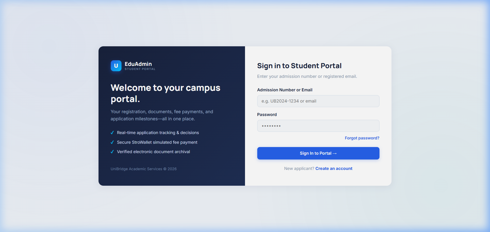
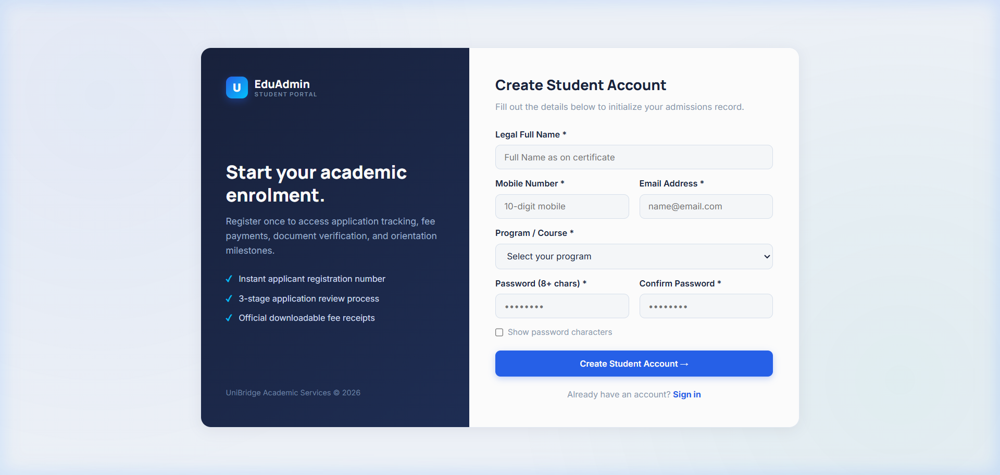
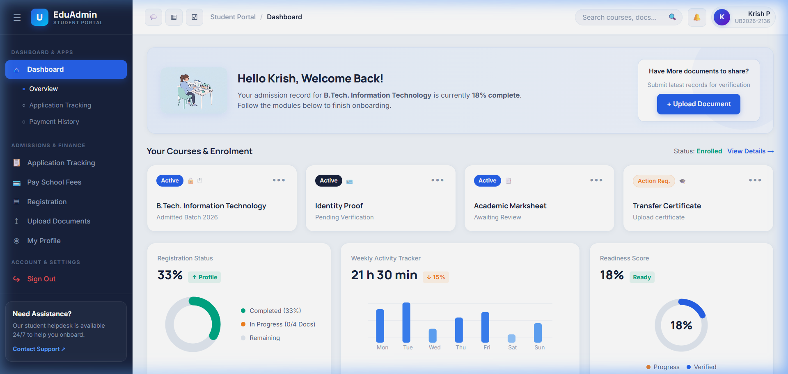
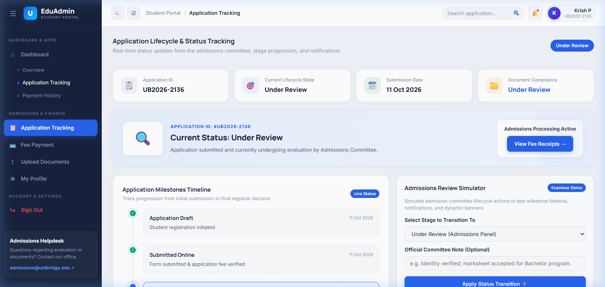
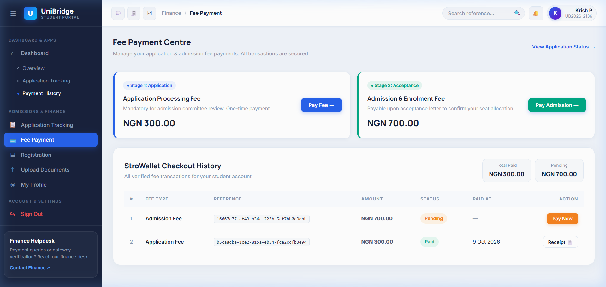
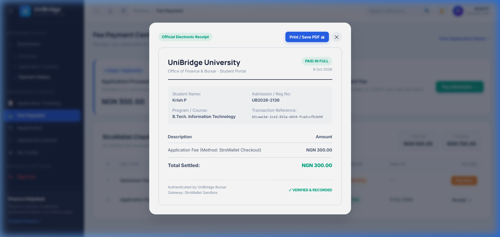

# UniBridge — Student Onboarding & Admissions Management Portal
> **Comprehensive Web Development Project Report**  
> **Repository:** [https://github.com/KrishPatel-Comp/WD-Mini-Project.git](https://github.com/KrishPatel-Comp/WD-Mini-Project.git)  
> **Latest Commit:** `41c6d53` (Branch: `main`)  
> **Tech Stack:** PHP 8.2 (Apache), MariaDB 11.4 / MySQL, Vanilla CSS 3 (EduAdmin Design System), JavaScript (ES Modules), Docker & Docker Compose  

---

## 1. Executive Summary

**UniBridge** is a modern, deployment-ready higher education student onboarding web application designed to streamline the journey from applicant registration to fee payment and formal enrolment. 

During this development cycle, the platform was re-architected to resolve mobile/desktop component overlap, implement the realistic **EduAdmin** navy design language, introduce an end-to-end **Application Lifecycle Tracker** with an interactive committee simulator, and deploy a simulated multi-channel **Fee Payment & Electronic Receipt System**.

---

## 2. UI/UX Design System & Anti-Overlap Engineering

Prior versions exhibited card crowding and text truncation on tablet and laptop screens. The styling was rebuilt from scratch using pure Vanilla CSS:

- **EduAdmin Navy Theme:** Dark navy sidebar (`#18223c`), royal blue interactive accents (`#2762eb`), and clean white content surfaces (`#f0f4fa`).
- **Responsive Breakpoint Hierarchy:** Media queries configured for `1280px`, `1024px`, `992px`, `768px`, and `480px` breakpoints eliminate element collisions.
  - Course grids dynamically scale from 4 columns down to 2 and 1.
  - Metric widgets and fee cards adapt without horizontal overflow.
- **Mobile Drawer Navigation:** Accessible hamburger menu toggle with backdrop blur overlay for mobile viewports.
- **Modern SaaS Typography:** Google Fonts **Inter** and **Manrope** replace default browser fonts for an academic SaaS feel.

---

## 3. Key System Modules & Application Showcase

### 3.1 Student Authentication & Account Provisioning
Secure authentication built on PHP sessions, CSRF token validation, and bcrypt (`PASSWORD_DEFAULT`) hashing. When a student signs up, the system automatically assigns an admission number (e.g., `UB2026-2136`) and establishes their baseline database records.

*Figure 1: EduAdmin Student Sign In Interface*

*Figure 2: Student Account Creation & Automatic ID Allocation*

---

### 3.2 Student Overview Dashboard
The dashboard provides a central view of the applicant’s readiness score, enrolled courses, interactive SVG performance charts, and direct navigation links across all student services.

*Figure 3: Student Overview Dashboard with Readiness Meter & Dynamic Charts*

---

### 3.3 Feature 5: Application Lifecycle & Status Tracking
The application tracking module delivers transparency into admission committee actions:
- **8 Lifecycle States:** `Draft`, `Submitted`, `Under Review`, `Documents Pending`, `Correction Required`, `Waitlisted`, `Approved`, and `Rejected`.
- **Milestone Timeline:** Chronological step progression featuring checkmarked completed steps, pulsing badges for active states, and registrar remarks.
- **Status Stats Row:** 4 KPI cards indicating Application ID, Active Lifecycle State, Submission Date, and Document Compliance.
- **Document Compliance Checklist:** Real-time verification status for ID cards, High School marksheets, and transfer certificates.
- **Admissions Review Simulator:** Built-in interactive testing control allowing evaluators and examiners to trigger status transitions and inspect timeline animations live.
- **Real-Time Notification Feed:** Logs all status transitions with unread indicators and category badges.

*Figure 4: Application Milestones Timeline, Document Checklist & Review Simulator*

---

### 3.4 Feature 6: Fee Payment, StroWallet Checkout & Receipts
A financial management module designed for educational portals:
- **Two-Stage Fee Architecture:** Stage 1 Application Processing Fee (NGN 300.00) and Stage 2 Admission & Enrolment Fee (NGN 700.00).
- **Simulated StroWallet Modal Gateway:** Sandboxed checkout supporting StroWallet Balance, Credit/Debit Card, and Direct Bank Transfer.
- **Transaction History:** Filterable transaction ledger with reference search, status pills (`Paid` / `Pending`), and inline *Pay Now* actions.
- **Official Electronic Receipt:** Printable receipt modal with student credentials, payment method, reference ID, and authenticated registrar seal with `window.print()` PDF generation.

*Figure 5: Fee Payment Centre & StroWallet Transaction Ledger*

*Figure 6: Authenticated Electronic Fee Receipt Modal*

---

## 4. Technical Architecture & Database Schema

The application follows a decoupled client-server architecture:
- **Frontend:** Vanilla HTML5, Vanilla CSS3, ES Module JavaScript (`api.js`, `utils.js`).
- **Backend:** RESTful PHP 8.2 endpoints communicating through JSON payloads with PDO prepared statements.

### Database Tables Overview
| Table Name | Purpose | Primary Columns |
| :--- | :--- | :--- |
| `student_login` | Student authentication credentials | `student_id (PK)`, `admission_no`, `email`, `password_hash`, `last_login` |
| `student_registration` | Student profile and contact details | `student_id (FK)`, `full_name`, `course`, `phone`, `admission_year` |
| `application_track` | Lifecycle tracking and committee remarks | `application_id (PK)`, `student_id`, `status (ENUM)`, `status_note`, `submitted_at` |
| `fee_payments` | Transaction records and verification | `payment_id (PK)`, `student_id`, `reference`, `fee_type`, `amount`, `status`, `paid_at` |
| `student_notifications` | Status alert notifications | `notification_id (PK)`, `student_id`, `title`, `message`, `type (ENUM)`, `is_read` |

---

## 5. Containerization & Deployment Pipeline

The project is packaged for Docker environments:
- **`Dockerfile`:** Configured with `php:8.2-apache`, `pdo_mysql`, Apache `mod_rewrite`, upload limits (10MB), and healthcheck endpoints.
- **`docker-compose.yml`:** Orchestrates the web application on port `8080`, MariaDB 11.4 on port `3306`, and phpMyAdmin on port `8081`.
- **Environment Management:** Uses `.env` variables for database credentials while `.gitignore` prevents secret exposure.

---

## 6. Project Deliverables

| Deliverable | Location | Description |
| :--- | :--- | :--- |
| **Microsoft Word Report** | [`docs/UniBridge_Project_Report.docx`](./UniBridge_Project_Report.docx) | Formal project report with embedded figures and tables |
| **Markdown Report** | [`docs/PROJECT_REPORT.md`](./PROJECT_REPORT.md) | Web-viewable report formatted for GitHub |
| **Application Screenshots** | [`docs/screenshots/`](./screenshots/) | High-resolution captures of all core workflows |
| **GitHub Repository** | [GitHub Repo](https://github.com/KrishPatel-Comp/WD-Mini-Project.git) | Version-controlled codebase |
